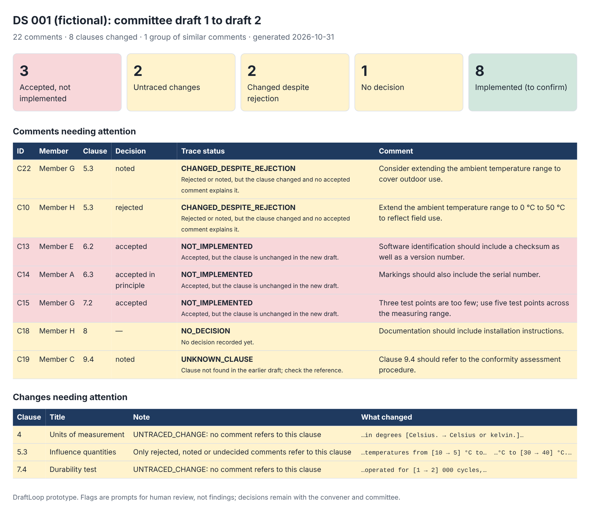
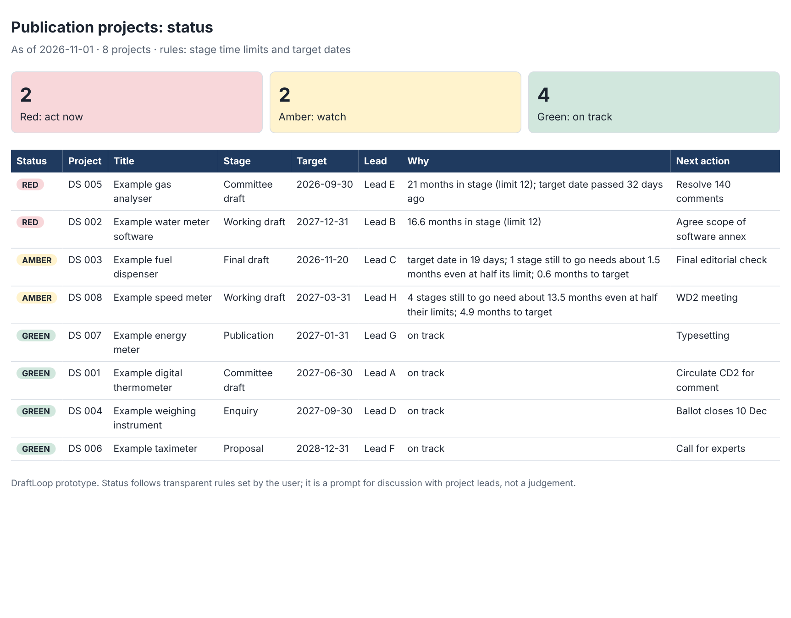

# DraftLoop

[](https://github.com/phahim1/draftloop/actions/workflows/tests.yml)


**Close the loop between ballot comments and the next draft, and see which projects are slipping before they slip.**

DraftLoop is a small, open-source prototype for people who manage the development of technical standards and guidance documents: committee secretaries, project managers, conveners and editors. It does two things:

- **Comment traceability.** It compiles member comments by clause, then checks clause by clause that every accepted comment is reflected in the revised draft and that every change in the revised draft can be traced back to a comment. Renumbered clauses are followed automatically.
- **Project early warning.** It reads a simple project register and flags projects at risk of missing their target dates, using transparent rules on stage time limits.

It is generic. It works with the comment tables, decision categories and Word drafts typical of international, regional and national standards development, and it can be adapted to any committee's own rules.



## Why

Comment resolution is where many standards projects lose time. Hundreds of comments arrive in different formats, the same point is raised by several members, and after the meeting someone has to confirm that every agreed change actually reached the next draft. This is normally checked by hand.

DraftLoop applies the discipline of a quality audit, where every decision must be traceable to evidence, to that step. It does not decide anything. It shows the people responsible where to look.

## What it does

### Comment traceability (`draftloop`)

1. **Compiles comments.** Reads comments from Excel, CSV or a Word table; normalises messy clause references (`Clause 5.2`, `5.2 a)`, `§5.2`, `Annex A.2`); sorts them by clause; and groups near-duplicate comments so they can be resolved together.
2. **Produces a disposition table.** A landscape Word document and an Excel sheet, with columns for the decision and observations.
3. **Checks traceability between drafts.** Compares draft *n* and draft *n+1* clause by clause and flags:

| Flag | Meaning |
|---|---|
| `NOT_IMPLEMENTED` | Accepted, but the clause is unchanged in the new draft |
| `UNTRACED_CHANGE` | A clause changed, but no comment refers to it |
| `CHANGED_DESPITE_REJECTION` | Rejected or noted, but the clause changed and no accepted comment explains it |
| `NO_DECISION` | No decision recorded yet |
| `UNKNOWN_CLAUSE` | The comment refers to a clause that does not exist |
| `IMPLEMENTED` | Accepted and the clause changed; a person confirms the change matches the decision |

Where a comment includes proposed text, DraftLoop also reports whether that text appears in the new draft. When a new clause is inserted and later clauses move down, DraftLoop matches clauses by content, so a renumbered clause is followed rather than reported as deleted and re-added.

4. **Reports.** An Excel workbook (summary, disposition, traceability, clause changes with word-level differences) and a one-page HTML summary.

### Project early warning (`draftloop-status`)

Reads a project register (project, stage, stage start date, target date, lead, next action) and gives each project a status:

| Status | Rule |
|---|---|
| Red | Target date passed, or the current stage has run longer than its time limit |
| Amber | Target date close, most of the stage's time limit used, missing dates, or the stages still to go cannot fit before the target even at half their time limits |
| Green | None of the above |

Every status comes with the reason in plain words. Stage names and time limits are set in a small JSON file ([`docs/stages.example.json`](docs/stages.example.json)), so the tracker follows your own directives rather than built-in assumptions.



## Two-minute demo

```bash
git clone https://github.com/phahim1/draftloop.git
cd draftloop
pip install -e .
python scripts/make_synthetic.py          # creates the fictional demo data
draftloop --comments data/synthetic/comments.xlsx \
          --decisions data/synthetic/decisions.xlsx \
          --old data/synthetic/draft_v1.docx \
          --new data/synthetic/draft_v2.docx \
          --out output
```

The demo uses a fictional draft standard ("DS 001, Example digital thermometer"), eight fictional members and 22 fictional comments, with problems planted on purpose. DraftLoop finds all of them:

```
Compiled 22 comments -> output/disposition.docx
Traceability: 3 accepted-not-implemented, 2 untraced changes, 2 changed-despite-rejection, 1 without decision
```

Then the project tracker, on eight fictional projects:

```bash
draftloop-status --projects data/synthetic/projects.xlsx --as-of 2026-11-01 --out output
# 8 projects: 2 red, 2 amber, 4 green
```

Sample outputs are in [`examples/output`](examples/output).

## Using your own files

- **Comments:** any table with at least a clause column and a comment column. Common headings (`MB`, `Clause/Subclause`, `Type of comment`, `Comments`, `Proposed change`, `Observations`) are recognised automatically. Other headings can be mapped with `--column-map` (see [`docs/column_map.example.json`](docs/column_map.example.json)).
- **Decisions:** in the comments file itself, or in a separate file with an ID and a decision column.
- **Drafts:** Word files where clause headings start with their number (`5.2 Maximum permissible errors`).

See [`docs/ADAPTING.md`](docs/ADAPTING.md) to align DraftLoop with your committee's directives.

## Responsible AI

- **No AI by default.** The core of DraftLoop is deterministic: text normalisation, fuzzy matching and clause-level comparison. The same input always gives the same result.
- **Optional, advisory, logged.** An assistance hook (`--assist module:function`) lets an organisation plug in a model of its choice, for example a locally hosted one, to suggest themes per clause. Every suggestion is written to an append-only audit log (`assist_audit.jsonl`) with the provider name, time, comment IDs and a hash of the input. Suggestions never change decisions. The bundled example provider uses no AI at all.
- **Confidentiality.** DraftLoop runs locally and sends nothing anywhere. Committee drafts should never be passed to external services without the owner's permission.
- **People decide.** Flags are prompts for review, not findings. Decisions stay with the convener and the committee.

## Limitations

- A prototype, tested on synthetic data only.
- Renumbered clauses are matched by content. A clause that is both renumbered and heavily rewritten may still appear as removed and added.
- Status rules use stage time limits, not prediction. They are only as good as the limits and dates entered.
- Changes inside figures, equations and tracked changes are not analysed; tables are read as plain text.
- A clause that changed for one accepted comment can hide a second accepted comment on the same clause that was not implemented. The proposed-text check helps, but a person still needs to confirm.
- Decision categories and comment-form fields differ between organisations. Check them against your own directives (see `docs/ADAPTING.md`).
- Not affiliated with, or endorsed by, any standards body.

## Project structure

```
draftloop/
  clauses.py   clause references: normalise, sort, scope
  ingest.py    comments, decisions and Word drafts
  compile.py   clause ordering and near-duplicate grouping
  trace.py     draft comparison and traceability flags
  report.py    Excel workbook and HTML summary
  status.py    project early-warning tracker
  assist.py    optional advisory hook with audit log (off by default)
  cli.py       command-line interface
scripts/make_synthetic.py   fictional demo data
tests/                      24 tests, run automatically on every push
```

Run the tests with `pip install -e .[dev] && pytest`.

## Roadmap

- Read tracked changes directly from Word drafts.
- Export the disposition table in a committee's own template.

## Licence

MIT. See [LICENSE](LICENSE).

## Author

Fahim ([@phahim1](https://github.com/phahim1)), Licensed Professional Engineer. Background in laboratory accreditation, metrology and international standards development.
